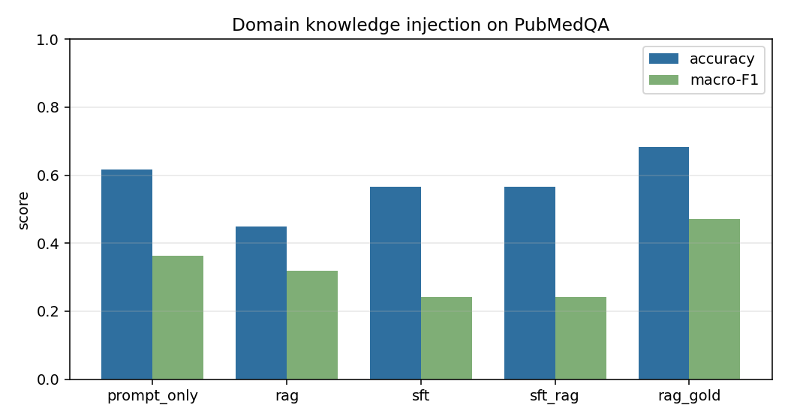

# VerticalLLM Lab: Prompt-only vs RAG vs Fine-tuning on PubMedQA

A small, fully reproducible benchmark that answers one practical question:

> When a small open-weight LLM lacks vertical-domain knowledge, what actually
> works better — **retrieving** the knowledge at inference time, or **fine-tuning**
> it into the weights?

Everything runs on a public dataset ([PubMedQA][pubmedqa], biomedical research
QA) with a 0.5B-parameter base model, and needs no GPU. The smoke configuration
is deliberately small, but CPU generation is still the slow part: the full
five-arm run takes roughly an hour (training ~10 min, ~15 min per arm). There is
no dependency on any paid API.

---

## Why this exists

Most "RAG vs fine-tuning" discussions are opinions. This project turns it into a
measurement: the same model, the same prompts, the same test set, the same
decoding settings — only the source of the domain knowledge changes.

| arm | where the knowledge lives | what it costs |
| --- | --- | --- |
| `prompt_only` | nowhere — parametric memory only | zero |
| `rag` | retrieved abstracts, injected into the prompt | a vector index + a lookup per query |
| `sft` | the model weights (LoRA), closed-book | a one-off training run |
| `sft_rag` | both | both |
| `rag_gold` | the *gold* abstract for each question | oracle upper bound, not deployable |

`rag_gold` is the reference point that makes the other numbers interpretable: it
measures what the generator could achieve if retrieval were perfect, so the gap
between `rag` and `rag_gold` tells you how much of the remaining error is the
retriever's fault rather than the model's.

## The task

PubMedQA turns a paper title into a research question and pairs it with the
abstract and a **yes / no / maybe** verdict plus a one-sentence conclusion:

```
Question:  Do mitochondria play a role in remodelling lace plant leaves during
           programmed cell death?
Verdict:   yes
Conclusion: Mitochondria play a critical role in the progression of PCD...
```

Each arm must output exactly two lines, and both are scored:

* **accuracy / macro-F1** on the verdict — is the label right?
* **ROUGE-L** on the conclusion — is the *reasoning* right, or did the model just
  guess a plausible-looking label?

Macro-F1 matters here because the label distribution is skewed; a model that
always answers `yes` can look surprisingly decent on raw accuracy.

## Split usage

| file | source | role |
| --- | --- | --- |
| `data/test.jsonl` | `pqa_labeled` (1k, human-annotated) | held-out test set |
| `data/train.jsonl` | `pqa_artificial` (211k, auto-labelled) | SFT training data |
| `data/corpus.jsonl` | `pqa_artificial` | retrieval corpus |

The two splits are disjoint by construction. On top of that, `prepare_data.py`
removes any corpus document that shares a PubMed id or an identical question with
a test record. Without that filter the retriever could hand the model the very
abstract the gold answer was derived from, which would inflate the RAG arm and
invalidate the whole comparison.

---

## Quickstart

```bash
git clone <this-repo> && cd vertical-llm-lab
pip install -r requirements.txt

# 1. download the dataset and build train/test/corpus
python3 scripts/prepare_data.py --config configs/cpu_smoke.yaml

# 2. build the retrieval index
python3 scripts/build_index.py    --config configs/cpu_smoke.yaml

# 3. baseline comparison (no training needed)
python3 scripts/evaluate.py       --config configs/cpu_smoke.yaml --arms prompt_only rag

# 4. fine-tune, then run the full four-way comparison
python3 scripts/train_sft.py      --config configs/cpu_smoke.yaml
python3 scripts/evaluate.py       --config configs/cpu_smoke.yaml \
                                  --arms prompt_only rag sft sft_rag rag_gold
```

Every script takes `--config` plus dotted overrides, so you never need to edit
the YAML to try a variant:

```bash
python3 scripts/prepare_data.py --config configs/default.yaml \
    --set data.max_train_samples=5000 data.corpus_size=10000
```

Outputs land in `results/`:

```
results/summary.json                  metrics for every arm
results/report.md                     rendered comparison (figure + takeaways)
results/comparison.png                accuracy / macro-F1 bar chart
results/<arm>_predictions.jsonl       per-question predictions, incl. retrieved evidence
```

### Configurations

| config | target | what it does |
| --- | --- | --- |
| `configs/cpu_smoke.yaml` | laptop CPU | 1.2k training rows, 600-doc corpus, 60 test questions, 40 training steps |
| `configs/default.yaml` | single GPU | 20k training rows, 30k-doc corpus, 500 test questions, 1 epoch |

### If huggingface.co is unreachable

Nothing to do — the entry points probe the official host and fall back to
`https://hf-mirror.com` automatically. This has to happen **before** anything
imports `transformers`, because `huggingface_hub` freezes its endpoint at import
time; that is the entire job of `src/vlab/bootstrap.py`. To choose a mirror
yourself:

```bash
export HF_ENDPOINT=https://hf-mirror.com     # or: --hf-endpoint https://hf-mirror.com
```

Xet transfers are disabled as well: `cas-server.xethub.hf.co` returns `401` on
several networks, and plain HTTPS is more portable.

---

## Results

Measured on a **CPU-only** machine (no GPU), `Qwen2.5-0.5B-Instruct`, 60 test
questions, a 600-document corpus and 40 LoRA steps (~160 training examples).
Reproduce with `make all CFG=configs/cpu_smoke.yaml`.

| arm | accuracy | macro-F1 | ROUGE-L | format compliance | s/answer |
| --- | --- | --- | --- | --- | --- |
| `prompt_only` | 0.617 | 0.363 | 0.182 | 0% | 16.6 |
| `rag` | 0.450 | 0.319 | 0.048 | 0% | 11.4 |
| `sft` | 0.567 | 0.241 | 0.183 | **100%** | 17.6 |
| `sft_rag` | 0.567 | 0.241 | 0.160 | **100%** | 16.6 |
| `rag_gold` (oracle) | **0.683** | **0.472** | 0.132 | 0% | 15.5 |



### Four things these numbers show

**1. Gold evidence helps in this sample.** With the gold abstract in context the
model reaches 0.683 accuracy, compared with 0.617 without evidence. This is an
observed result for this small test, not a general estimate of the benefit.

**2. RAG underperforms both the no-evidence and gold-evidence runs in this smoke
test.** `rag` scores 0.450, versus 0.617 for `prompt_only` and 0.683 for
`rag_gold`. Retrieved evidence can be irrelevant, but the gap alone does not
isolate retrieval as the cause: evidence use and prompt behavior may also
contribute. The gold-evidence run is a reference condition, not a strict upper
bound on model performance.

**3. Fine-tuning improved format compliance but collapsed to one label.**
Compliance went from 0% to 100%, while accuracy was 0.567 versus 0.617 for
`prompt_only`; all SFT predictions were `yes`. This small run demonstrates a
format-following change, not a reliable improvement in domain knowledge.

**4. No arm ever predicted `maybe`.** All five collapse onto yes/no against a gold
distribution of 57/30/13, which is why macro-F1 stays in the 0.24–0.47 range even
for the best arm. A single accuracy number would have hidden this.

### Where to take it next

This is a smoke run — 0.5B parameters, 60 questions, 160 training examples. The
methodology scales; these absolute numbers do not deserve to be quoted. Two
experiments to try next:

* **Increase retrieval coverage.** Try `data.corpus_size: 600 → 30000` and
  evaluate retrieval relevance to test whether a larger corpus helps.
* **Train beyond the smoke limit.** Remove `sft.max_steps` and use the full 20k
  rows, while tracking per-class performance to see whether domain performance
  improves without collapsing to one label.

## Reading the result

The usual pattern, and what it implies:

* **RAG can suit volatile facts.** Updating an index is cheap; retraining is not.
  It also gives you citations for free, which matters in regulated domains.
* **Fine-tuning can help with behaviour.** It may make a small model follow a
  stricter output format or adopt domain vocabulary without repeating lengthy
  examples in every prompt.
* **They are not substitutes.** Facts change, style does not. The `sft_rag` arm
  can combine the two approaches: fine-tune the *behaviour*, retrieve the *facts*.
* **Small models collapse onto one verdict.** Watch the prediction distribution in
  `results/summary.json`; if `prompt_only` answers `yes` 80% of the time, its
  accuracy number reflects the label prior more than any real competence.

## Project layout

```
src/vlab/
  config.py        typed config + dotted overrides
  data/pubmedqa.py dataset download, normalization, leakage guard
  data/corpus.py   bi-encoder + FAISS retriever
  backends.py      model loading and batched generation
  arms.py          the four (+oracle) experiment arms
  finetune.py      LoRA SFT with completion-only loss masking
  evaluate.py      metrics, markdown report, bar chart
  prompts.py       one shared prompt template for every arm
scripts/           CLI entry points
configs/           YAML configurations
```

## Using a different vertical domain

The pipeline only assumes three jsonl files. Produce them in this schema and the
rest of the project works unchanged:

```jsonc
// data/train.jsonl and data/test.jsonl
{"pid": "21645374",
 "question": "Does X predict Y?",
 "verdict": "yes",               // any small label set
 "conclusion": "one sentence",   // the free-text rationale
 "context": "the supporting document text"}

// data/corpus.jsonl  (retrieval corpus)
{"pid": "21645374", "question": "...", "context": "..."}
```

Then update the label set in `src/vlab/prompts.py` (`VERDICTS`) and the output
template. Good candidates:

* **Legal** — [CaseHOLD][casehold] (holdings selection; the cited opinions are a
  natural retrieval corpus).
* **Finance** — [FiQA][fiqa] or ConvFinQA over 10-K filings.
* **Internal knowledge base** — your own tickets/wiki, with (question, answer)
  pairs as SFT data and the raw documents as the corpus.

## Limitations

* The smoke configuration is sized for a laptop and uses a 600-document corpus.
  Its RAG result is specific to this corpus and run; it should not be treated as
  a general lower bound on RAG performance.
* No arm, in any configuration tried, ever emitted `maybe`. A 0.5B model does not
  have the calibration to express genuine uncertainty, and 13% of the test set
  carries that label — a hard ceiling on macro-F1.
* Prompt layout moves the RAG number a lot at this scale. Placing the question
  *after* the evidence made the base model emit a single word and stop; moving it
  before the evidence raised `rag` accuracy from 0.283 to 0.450. Treat prompt
  engineering and retrieval quality as confounders, not constants.
* Verdicts are scored by exact match; `maybe` is inherently fuzzy and human
  agreement on PubMedQA is around 78%.
* ROUGE-L is lexical. For a stronger semantic check, swap in BERTScore.
* One seed, one model size. Treat the numbers as a demonstration of the
  methodology, not as a published benchmark.

## Future Improvements

These items require new runs or additional evaluation; the current result files
do not establish their outcomes:

* **Strengthen the evaluation set.** Evaluate on the full held-out labeled split,
  use a documented deterministic sampling strategy for smoke runs, and report
  confidence intervals across multiple seeds.
* **Address SFT label collapse.** Measure the training label distribution, try
  stratified or class-balanced sampling and validation-based model selection,
  then rerun all arms on the same untouched test set.
* **Measure retrieval directly.** Add Recall@k/MRR or human relevance labels;
  compare larger corpora, hybrid sparse+dense retrieval, reranking and top-k
  settings before attributing the RAG gap to the retriever.
* **Measure end-to-end cost.** Record retrieval, prompt preparation and
  generation separately, including warm-up and repeated latency/throughput
  measurements. The current `s/answer` values cover generation only.
* **Keep data and result snapshots aligned.** The checked-in test file contains
  100 rows, while the saved predictions contain 60 because evaluation was capped
  by the smoke configuration. Regenerate and version a consistent snapshot, and
  preserve per-arm run metadata when combining results.
* **Validate accelerator runs.** Run the pipeline on a supported GPU and record
  actual device placement, peak memory and throughput; the checked-in results
  were produced on CPU.

---

## References

* Jin et al., *PubMedQA: A Dataset for Biomedical Research Question Answering*,
  EMNLP 2019. ([paper][pubmedqa-paper])
* Lewis et al., *Retrieval-Augmented Generation for Knowledge-Intensive NLP Tasks*,
  NeurIPS 2020. ([paper][rag-paper])
* Hu et al., *LoRA: Low-Rank Adaptation of Large Language Models*, ICLR 2022.
  ([paper][lora-paper])

[pubmedqa]: https://huggingface.co/datasets/qiaojin/PubMedQA
[pubmedqa-paper]: https://aclanthology.org/D19-1259/
[casehold]: https://huggingface.co/datasets/casehold/casehold
[fiqa]: https://huggingface.co/datasets/ChanceFocus/flare-fiqasa
[rag-paper]: https://arxiv.org/abs/2005.11401
[lora-paper]: https://arxiv.org/abs/2106.09685
